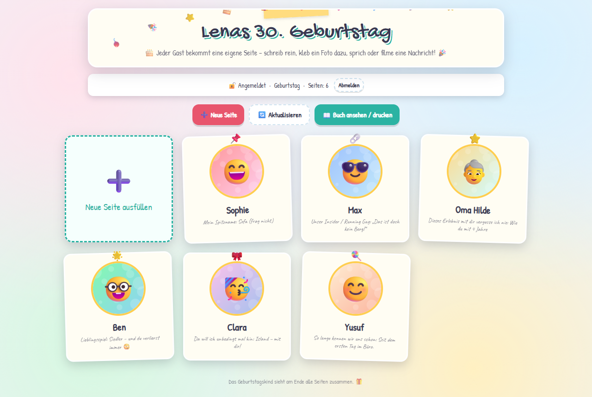
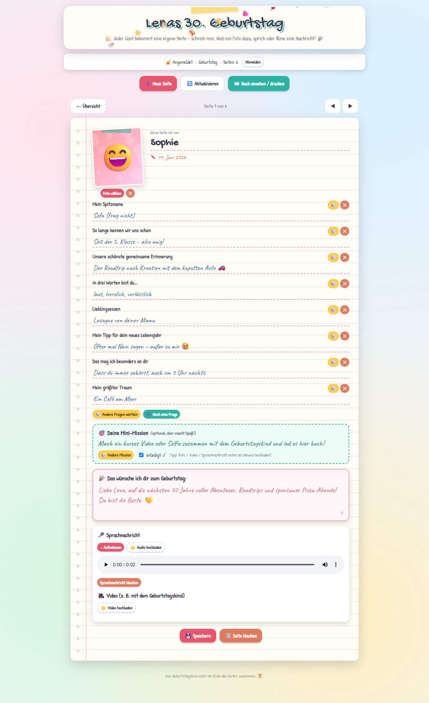
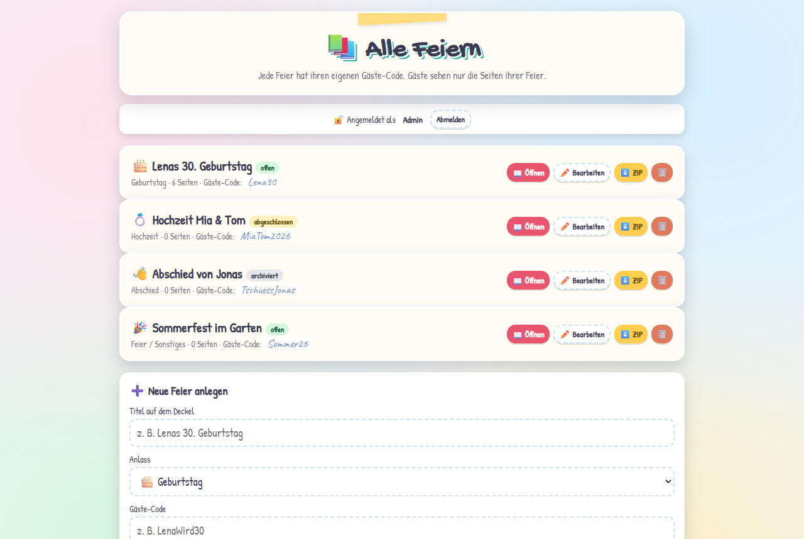
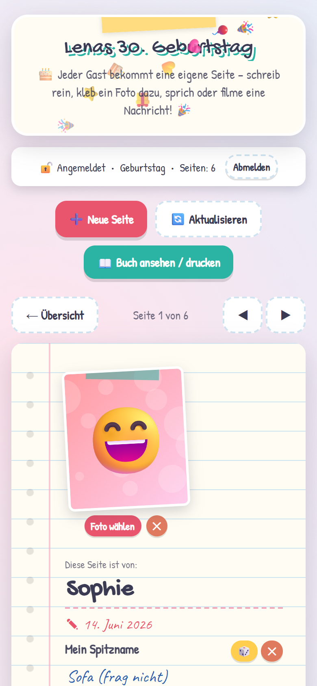

# Freundebuch

Ein digitales Freundebuch für Feiern. Ich habe es ursprünglich für meinen eigenen Geburtstag gebaut:
Die Gäste bekommen einen Link und einen Code, legen sich eine eigene Seite an, beantworten ein paar
Fragen, kleben ein Foto ein und können eine Sprachnachricht oder ein Video dalassen. Dazu gibt es
pro Seite eine kleine Mission, z. B. ein Prost-Foto mit dem Geburtstagskind.

Am Ende kann man sich alles als Buch ansehen, ausdrucken oder als ZIP herunterladen.



## Was es kann

- Mehrere Feiern auf einer Installation. Jede Feier hat ihren eigenen Gäste-Code, Gäste sehen nur
  ihre eigene Feier. Eine Feier kann man abschließen (dann nur noch ansehen) oder archivieren.
- Anlässe: Geburtstag, Hochzeit, Abschied oder Sonstiges. Davon hängen die Texte und die
  vorgeschlagenen Fragen und Missionen ab.
- Fragen und Missionen lassen sich pro Feier im Admin-Bereich anpassen.
- Fotos, Videos und Sprachnachrichten können direkt im Browser aufgenommen werden (braucht https),
  sonst über die normale Dateiauswahl am Handy.
- Jeder Gast kann seine eigene Seite bearbeiten, fremde Seiten nur ansehen.
- Buchansicht zum Drucken bzw. als PDF speichern, und ein ZIP-Export mit allen Medien und einer
  HTML-Datei, die auch ohne Server funktioniert.
- Keine Datenbank, keine externen Dienste. Alles liegt als Dateien auf dem eigenen Webspace.

Die Oberfläche ist auf Deutsch.

| Gästeseite | Admin-Bereich |
|---|---|
|  |  |

<p>
  
</p>

(Namen und Inhalte in den Screenshots sind ausgedacht.)

## Installation

Voraussetzung ist ein Webspace mit PHP 7 oder neuer. Für den ZIP-Export braucht man die
PHP-Erweiterung `zip`, die bei den meisten Hostern aktiv ist.

1. `config.example.php` nach `config.php` kopieren und einen eigenen `FB_ADMIN_CODE` eintragen.
2. Alles per FTP hochladen, z. B. nach `/freundebuch/`. Der Ordner muss für PHP beschreibbar sein.
3. Die Seite aufrufen und mit dem Admin-Code anmelden.
4. Eine Feier anlegen (Titel, Anlass, Gäste-Code) und Link und Code an die Gäste schicken.

Zum lokalen Ausprobieren reicht:

```bash
cp config.example.php config.php
php -S localhost:8000
```

## Daten und Sicherheit

Alles liegt im Ordner `data/`:

```
data/events.json                      die Feiern mit Titel, Anlass, Code und Status
data/events/<feier>/pages/<id>.json   eine Datei pro Gästeseite
data/events/<feier>/media/            Fotos, Sprachnachrichten, Videos
```

`data/` wird per `.htaccess` gesperrt, Medien liefert `api.php` nur an angemeldete Gäste der
jeweiligen Feier aus. Unter nginx muss man den Ordner selbst sperren:

```nginx
location ^~ /freundebuch/data/ { deny all; }
```

Das Bearbeitungsrecht für eine Seite wird im Browser des Gastes gespeichert. Wer seine Browserdaten
löscht oder das Gerät wechselt, kann die Seite danach nur noch ansehen; als Admin kann man sie
weiterhin bearbeiten.

Die Codes halten Fremde fern, mehr aber auch nicht. Also einen langen Admin-Code nehmen und nichts
hochladen, was auf keinen Fall öffentlich werden darf. Zum Sichern einfach `data/` herunterladen oder
den ZIP-Export nutzen.

Uploads sind auf 80 MB pro Datei begrenzt (`FB_MAX_UPLOAD` in `api.php`). Wenn der Hoster weniger
erlaubt, müssen `upload_max_filesize` und `post_max_size` in der PHP-Konfiguration angepasst werden.

## Lizenz

MIT, siehe [LICENSE](LICENSE). Die Schriften in `fonts/` (Caveat, Gochi Hand, Patrick Hand) stehen
unter der SIL Open Font License.
